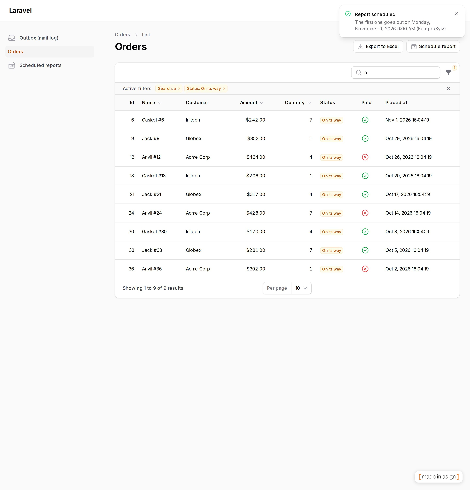
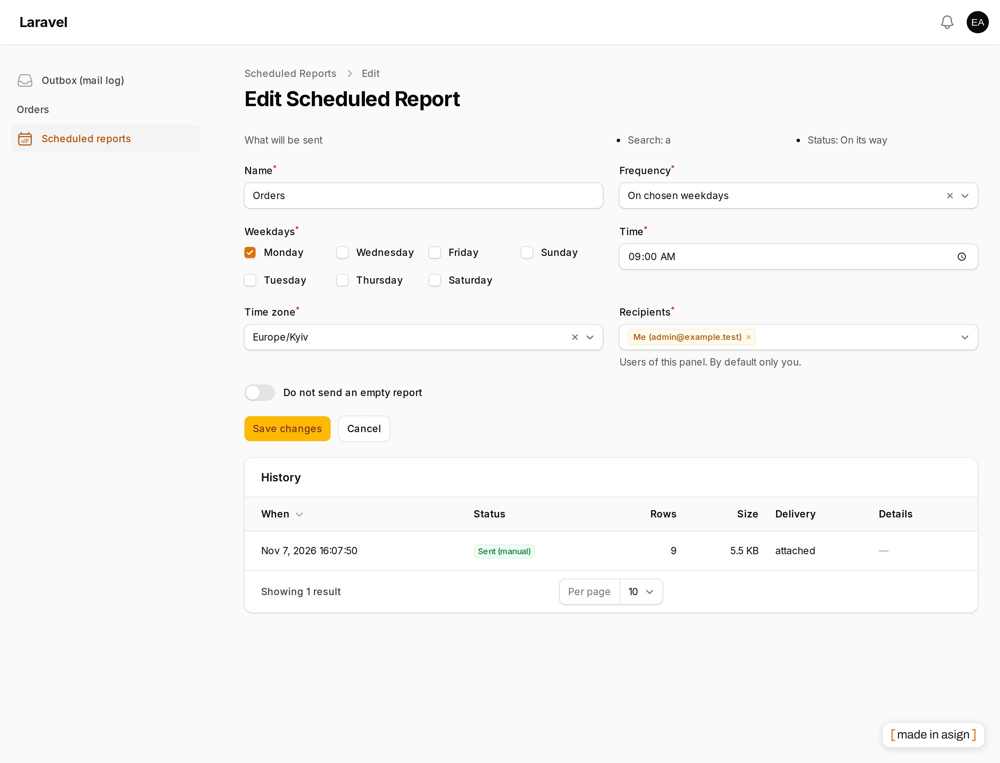

# Filament Scheduled Reports

[](https://stand-with-ukraine.pp.ua)
[](https://packagist.org/packages/asignua/filament-scheduled-reports)
[](https://github.com/asignua/filament-scheduled-reports/actions/workflows/tests.yml)
[](https://github.com/asignua/filament-scheduled-reports/blob/main/LICENSE.md)

Every Monday you open a table, set the same filters, press «Export» and forward the file. This plugin does it for you:
**«send this table every Monday at 9:00»**. It is the scheduling companion of
[filament-xlsx-export](https://github.com/asignua/filament-xlsx-export) and reuses its export, so the file is the one the
Export button would have produced.

- One header action, **Schedule report**: saves the current filters, search, sort, the export's columns and options, plus a schedule and recipients.
- **Daily, on chosen weekdays, or on a day of the month** (the 31st in February is the last day of the month). No cron expressions.
- Runs **in the owner's time zone**; `next_run_at` is stored in UTC. A time that does not exist when the clocks go forward becomes the first valid minute; a time that happens twice runs once, at the first occurrence.
- **Exactly once**: the run is claimed with one atomic `UPDATE … WHERE next_run_at = <what I read>`; overlapping cron ticks and several workers cannot send a report twice. After downtime there is **one** catch-up run, not a series.
- **Never more data than the owner sees now**: the report runs as its owner (`canAccessPanel`, the `scheduleReport` gate, the page's own access, the action's visibility). If the owner is gone or lost access, the report **pauses** and no file is made.
- Recipients: only the panel users you offer (default: only the owner). Outside email addresses are **off by default**, and work only for the domains you list.
- Every mail has a signed **unsubscribe** link (and the `List-Unsubscribe` one-click header).
- **No silent failures**: three failed runs in a row pause the report and tell the owner; a table that outgrew the export cap is recorded and the owner is told.
- A resource, **Scheduled reports**: your own (everybody's for `manageScheduledReports`), history of runs, pause / resume, run now, duplicate, delete. The filters are shown as text so you can see what will be sent.
- Interface in 10 languages: de, en, es, fr, it, nl, pl, pt_BR, tr, uk (all but en and uk are machine translations: corrections welcome).





## Requirements

PHP 8.3+, Laravel 12 or 13, Filament 5, `asignua/filament-xlsx-export` ^1.1 (installed with it), a working **queue worker** and the Laravel **scheduler** (`php artisan schedule:run` every minute), and a mail transport. Without a queue worker mail and runs are not sent: the queue is where they go.

## Installation

```bash
composer require asignua/filament-scheduled-reports
php artisan migrate
```

The migration is loaded from the package. Register the plugin on every panel that should offer it:

```php
use Asignua\FilamentScheduledReports\ScheduledReportsPlugin;

$panel->plugin(
    ScheduledReportsPlugin::make()
        // Whom the owner may add besides themselves: id => label. Default: nobody, only the owner.
        ->recipients(fn (User $owner): array => $owner->team->users()->pluck('name', 'id')->all())
);
```

Add the button next to the export on any table page (`ListRecords` or your own `Page` with a table):

```php
use Asignua\FilamentScheduledReports\Actions\ScheduleReportAction;

protected function getHeaderActions(): array
{
    return [XlsxExportAction::make(), ScheduleReportAction::make()];
}
```

The action finds the export action by name (`xlsxExport`; `->exportAction('name')` for another) and inherits its column picker and options.

## Gates (denied until you define them)

```php
Gate::define('scheduleReport', fn (User $user, ?string $page = null) => $user->can('reports.schedule')); // $page: the page class
Gate::define('manageScheduledReports', fn (User $user) => $user->isAdmin());                              // see and pause everybody's
```

Without `scheduleReport` there is no button, the resource is closed and stored reports do not run. A false answer later pauses the report as `owner_lost_access`.

## Outside recipients

```php
ScheduledReportsPlugin::make()
    ->allowExternalRecipients()
    ->allowedDomains(['example.com']); // exact match; a subdomain is another domain; no domains = nobody
```

The form says it plainly: **every recipient gets the data the owner can see**, whatever their own access.

## How a run works

`scheduled-reports:run` (registered every minute; `schedule.enabled` in the config) claims due reports and queues a job. The job acts as the owner, builds the page component **from stored plain data** (page class, filters, search, sort, columns, export options) with no HTTP request and **no Livewire snapshot**, asks the table for its own query and writes the file with the export's code. The file is attached up to `max_attachment_mb` (10); a bigger one goes as a link that needs a sign-in as the owner, and only the owner gets it.

Pauses: `owner_lost_access` (inactive, deleted, no panel, gate or page access), `target_gone` (panel, page, action, a used filter or tab, or every saved column is gone), `tenancy_unsupported`, `failed`, `no_recipients`, `manual`. A removed column is dropped with a warning in the history.

## Limits

- **Panels with tenancy are not supported in v1**: there is no button, and a stored report on such a panel pauses. The background export of xlsx-export cannot carry a tenant yet.
- Pages only (not relation managers); header action only, no row selection.
- Recipients are not given a separate data scope: they see the owner's data.
- Panel notifications about failures are sent only if the panel has database notifications; the mail always goes.

## Configuration

`php artisan vendor:publish --tag=filament-scheduled-reports-config` — table names, schedule, attachment size, queue and connection, failure limit, history retention (`history_days`, pruned daily by `scheduled-reports:prune`), the «Run now» interval. Translations: `--tag=filament-scheduled-reports-translations`.

## Testing

`vendor/bin/phpunit`. The race tests need real databases: `bash tests/Databases/run.sh` starts throwaway MariaDB 11.4 and PostgreSQL 16 containers and removes them. The workbench: `bash workbench/serve.sh` (seeded users in the script).

## More plugins by asign

- [XLSX Export](https://filamentphp.com/plugins/asign-xlsx-export) — typed `.xlsx` downloads of what is on the screen
- [XLSX Import](https://filamentphp.com/plugins/asign-xlsx-import) — import `.xlsx`, `.ods` and `.csv` into any model
- [Mail Log](https://filamentphp.com/plugins/asign-mail-log) — every message your app sends
- [Activity Log Plus](https://filamentphp.com/plugins/asign-activity-log-plus) — an audit trail for resources
- [Redirects](https://filamentphp.com/plugins/asign-redirects) — redirects and the 404 log

All plugins: <https://filamentphp.com/plugins?q=asign>

## License

The MIT License (MIT). See [LICENSE.md](https://github.com/asignua/filament-scheduled-reports/blob/main/LICENSE.md).
